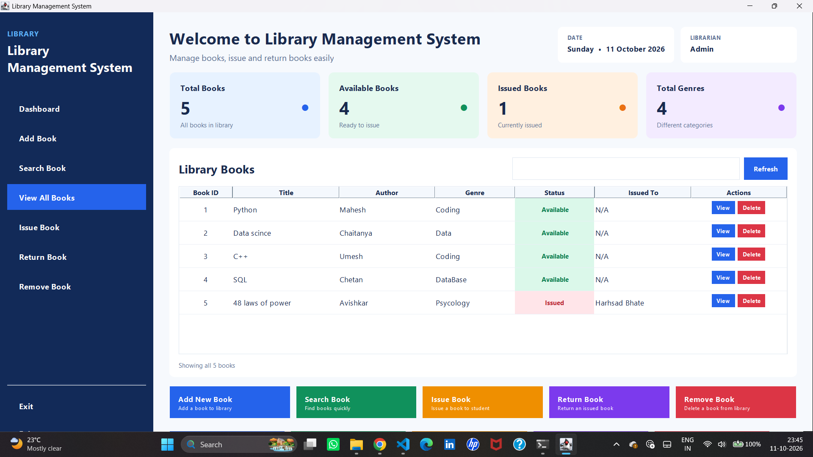
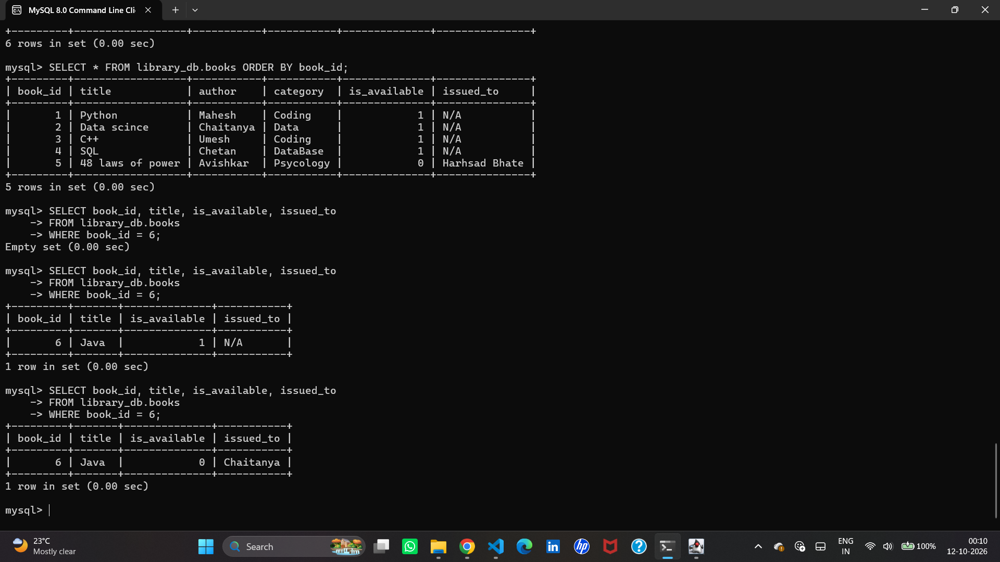

# 📚 Library Management System

A Java Swing desktop application for managing library book records. The application uses **Core Java**, **Swing**, **JDBC**, and **MySQL** to provide a graphical interface for common book-management and circulation tasks.

**Author:** Chaitanya Takale  
**GitHub:** [Chaitanya100000](https://github.com/Chaitanya100000)  
**Repository:** [Library-Management-System](https://github.com/Chaitanya100000/Library-Management-System)

## 📸 Screenshots

### Library Management System dashboard



The dashboard displays book records, availability, issued status, and navigation for library operations.

### MySQL database output



This screenshot shows records stored in the `library_db.books` table, including availability and borrower details. The rows shown are sample development data and may differ from your local database.

## ✨ Features

- Add new book records
- View the list of books
- Search for books
- Issue an available book to a borrower
- Return an issued book
- Remove a book record
- Store book records in MySQL for persistence
- Display library information through a Java Swing GUI
- Handle book-not-found cases with a custom exception

## 🧰 Technologies

| Technology | Purpose |
|---|---|
| Java | Application logic and object-oriented programming |
| Java Swing | Desktop graphical user interface |
| JDBC | Connects Java to MySQL |
| MySQL | Persistent storage for book records |
| MySQL Connector/J | JDBC driver |
| Git and GitHub | Version control and source-code hosting |

## 📁 Project structure

```text
Library-Management-System/
├── lib/
│   └── mysql-connector-j-26.7.0/
│       └── mysql-connector-j-26.7.0.jar
├── screenshots/
│   ├── dashboard.png
│   └── database-output.png
├── Book.java
├── BookDAO.java
├── BookNotFoundException.java
├── DBConnection.java
├── Librarian.java
├── Library.java
├── LibraryGUI.java
├── Main.java
├── Menu.java
├── Student.java
├── User.java
├── .gitignore
└── README.md
```

The tree above highlights the main files. Keep any additional files already required by your project.

## ⚙️ Requirements

- Windows or another desktop OS supported by your installed Java version
- JDK installed (a compatible JDK with `javac`)
- MySQL Server running locally
- MySQL Connector/J JAR included in the project
- A terminal or Java IDE such as Visual Studio Code

Verify Java is available in PowerShell:

```powershell
java -version
javac -version
```

## 🗄️ MySQL database setup

### 1. Start MySQL

Start your local MySQL Server. You can use MySQL Workbench or the MySQL command-line client to run SQL statements.

### 2. Create the database and table

The project uses the database `library_db` and table `books`. If you already have this database and table, inspect them first instead of recreating them:

```sql
USE library_db;
DESCRIBE books;
SELECT * FROM books ORDER BY book_id;
```

For a fresh database, the following schema matches the project’s documented table structure:

```sql
CREATE DATABASE IF NOT EXISTS library_db;
USE library_db;

CREATE TABLE IF NOT EXISTS books (
    book_id INT PRIMARY KEY AUTO_INCREMENT,
    title VARCHAR(200) NOT NULL,
    author VARCHAR(150) NOT NULL,
    category VARCHAR(100),
    is_available TINYINT(1) DEFAULT 1,
    issued_to VARCHAR(150) DEFAULT 'N/A'
);
```

If your existing `books` table has a different schema, use `DESCRIBE books;` and make the code and schema consistent. Do not drop an existing database just to run this setup.

### 3. Configure the JDBC connection

Open `DBConnection.java` and verify that the URL points to your local database:

```java
jdbc:mysql://localhost:3306/library_db
```

Configure the MySQL username and password for your own machine. **Do not publish your real database password in GitHub.** Replace hard-coded secrets with placeholders before committing, and use a local configuration or environment variables for credentials. If a real password was already pushed publicly, change it in MySQL and remove it from the code/history as appropriate.

### 4. Confirm the database contains records

In MySQL, run:

```sql
USE library_db;
SELECT * FROM books ORDER BY book_id;
```

The GUI should display data from the same database. After adding, issuing, returning, or removing a book, run the query again to verify the result.

## ▶️ Compile and run (Windows PowerShell)

Open PowerShell in the project root — the folder containing `Main.java` — and make sure the connector JAR is at the path shown below. If your JAR is in a different folder, update the path in both commands.

Compile:

```powershell
javac -cp ".;lib\mysql-connector-j-26.7.0\mysql-connector-j-26.7.0.jar" *.java
```

Run:

```powershell
java -cp ".;lib\mysql-connector-j-26.7.0\mysql-connector-j-26.7.0.jar" Main
```

If you use VS Code, you can also open the project folder, ensure the JAR is included in the Java classpath, and run `Main.java`.

## 🧪 Suggested test checklist

1. Launch the application and confirm the dashboard opens.
2. View the book list and search for an existing title.
3. Add a test book and verify it appears in the GUI and MySQL.
4. Issue an available book and verify `is_available` changes to `0` and `issued_to` contains the borrower.
5. Return the book and verify `is_available` changes back to `1` and `issued_to` resets to `N/A`.
6. Remove a test book and verify the record is no longer in the table.
7. Restart the application and confirm the stored records remain available.

## 🔒 Security

- Never commit real passwords, API keys, or private configuration files.
- Keep local credentials out of screenshots and source control.
- Use a MySQL account with only the permissions the application needs.

## 🎓 Project objective

This academic project demonstrates object-oriented programming, Java Swing GUI development, JDBC connectivity, SQL-based data operations, exception handling, and persistent data storage.

## 📄 License

No license has been added yet. Add a license file if you want to define how others may use, modify, or redistribute the project.
